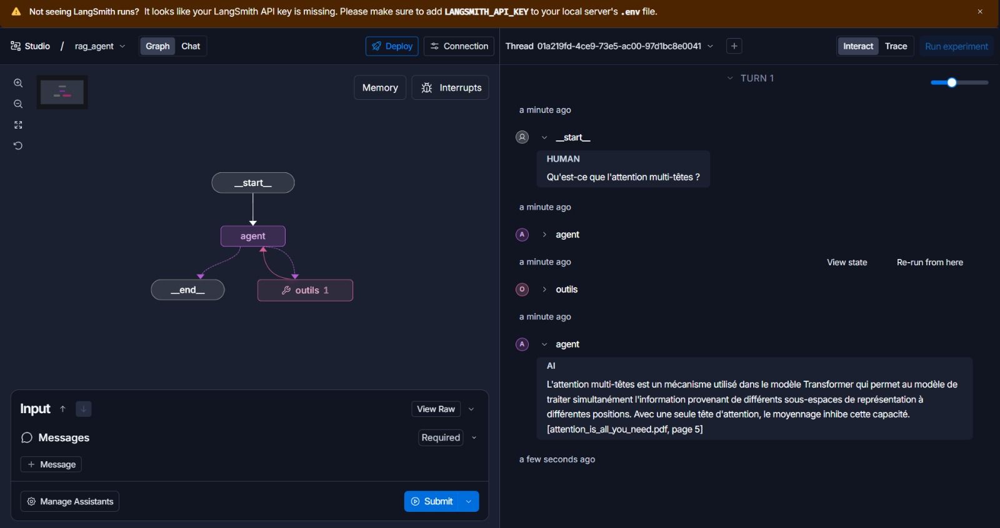
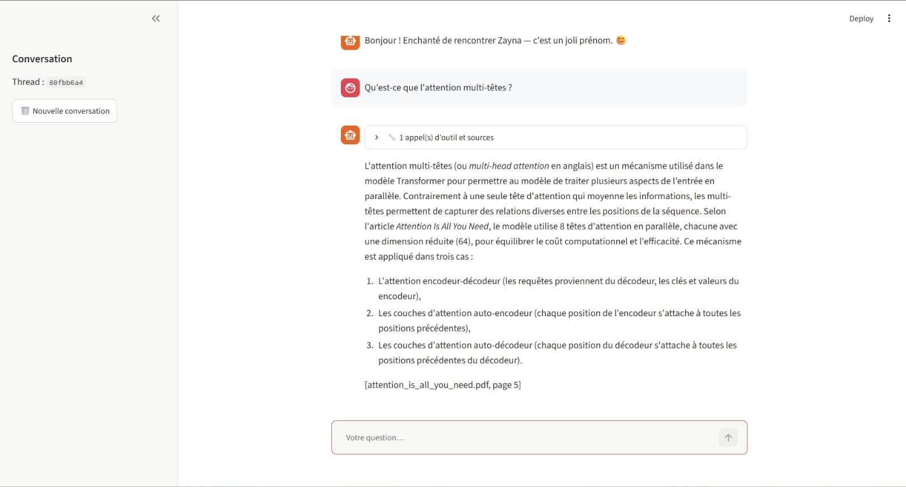
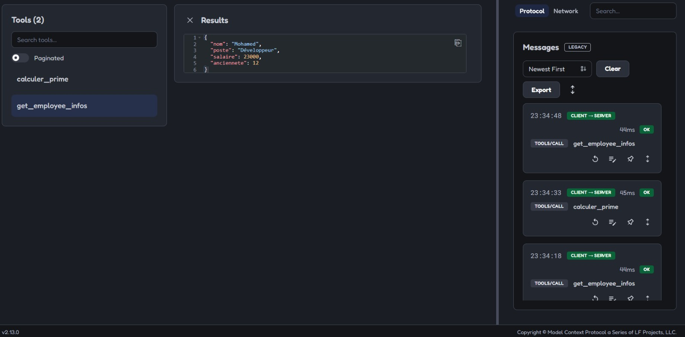
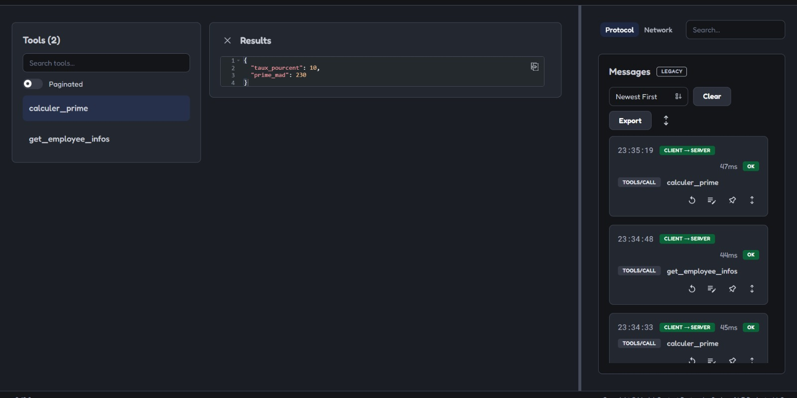

# Agentic AI et MCP — TP5

Agents IA avec LangChain et LangGraph, RAG agentique, serveurs MCP, agent n8n
et orchestration multi-agents d'un service après-vente.
LLM local : Ollama (qwen3:4b, qwen3:1.7b, qwen3-vl:4b pour la vision) · Embeddings : nomic-embed-text

## Progression
### A. LangChain
- [x] Étape 0 : Initialisation
- [x] Étape 1 : Agent simple + mémoire
- [x] Étape 2 : Tools personnalisés
- [x] Étape 3 : Tools prédéfinis (DuckDuckGo, Tavily, PythonREPL)
- [x] Étape 4 : Middlewares
- [x] Étape 5 : Chatbot RAG agentique

### B. LangGraph
- [x] Étape 6 : Bases de LangGraph
- [x] Étape 7 : Chatbot Agentic RAG
- [x] Étape 8 : LangGraph Studio
- [x] Étape 9 : Interface Streamlit

### C. MCP
- [x] Étape 10 : Serveur MCP (2 tools) + Inspector
- [x] Étape 11 : Agent LangChain client MCP (streamable-http)
- [x] Étape 12 : Agent n8n client MCP

### D. Synthèse
- [x] Étape 13 : SAV multi-agents (orchestrateur, agent documentaire via MCP, agent garantie)

## Installation
    uv sync
    ollama pull qwen3:4b
    ollama pull qwen3:1.7b
    ollama pull qwen3-vl:4b
    ollama pull nomic-embed-text

Créer un fichier `.env` contenant `TAVILY_API_KEY=...` (clé gratuite sur tavily.com).
Node.js est nécessaire pour l'Inspector MCP et pour n8n.

## Structure du projet
| Dossier / fichier | Contenu |
|---|---|
| `notebooks/01` à `05` | Partie A : agent, mémoire, tools, middlewares, RAG agentique |
| `notebooks/06`, `07` | Partie B : bases de LangGraph, Agentic RAG |
| `notebooks/11` | Partie C : agent LangChain client MCP |
| `notebooks/13` | Partie D : tests du SAV multi-agents |
| `app/rag_agent.py` | Chatbot Agentic RAG en LangGraph (utilisé par Studio et Streamlit) |
| `app/streamlit_app.py` | Interface web Streamlit |
| `app/sav_orchestrateur.py` | Orchestrateur LangGraph du SAV et ses deux agents |
| `mcp_server/server.py` | Serveur MCP RH : `get_employee_infos`, `calculer_prime` (port 24000) |
| `mcp_server/sav_rag_server.py` | Serveur MCP SAV : `rag_multimodal` (port 24001) |
| `scripts/creer_donnees_sav.py` | Génère le manuel PX-200, les figures, la photo client et le registre des garanties |
| `n8n/` | Workflow n8n exporté |
| `langgraph.json` | Configuration de LangGraph Studio |
| `captures/` | Captures d'écran |

## Partie A : LangChain
- **Agent + mémoire** : `create_agent` avec `InMemorySaver` ; chaque `thread_id` a son propre historique.
- **Tools** : outils personnalisés (`@tool`) et prédéfinis (DuckDuckGo, Tavily, PythonREPL). Le LLM choisit
  et enchaîne les outils d'après leur description (cycle ReAct : raisonnement → action → observation).
- **Middlewares** : `dynamic_model` (petit ou grand modèle selon la question), `dynamic_prompt` (prompt adapté
  au niveau de l'utilisateur), gestion des erreurs d'outils, guardrails (filtre de contenu, masquage des emails
  avec `PIIMiddleware`) et Human in the Loop (validation humaine avant l'envoi d'un email).
- **RAG agentique** : PDF → chunks → embeddings `nomic-embed-text` → Chroma. L'agent décide lui-même quand
  chercher, cite ses sources et dit quand l'information est absente.

## Partie B : LangGraph
- **Bases** : état, nœuds, arêtes conditionnelles, boucle, agent ReAct construit à la main, mémoire.
- **Chatbot Agentic RAG** : graphe `agent ⇄ outils` dans `app/rag_agent.py`, réutilisé tel quel par Studio et Streamlit.

### LangGraph Studio
    uv run langgraph dev --allow-blocking



### Interface Streamlit
    uv run streamlit run app/streamlit_app.py



## Partie C : MCP
### Serveur MCP
    uv run python mcp_server/server.py      # http://localhost:24000/mcp




### Agent LangChain (client MCP)
`notebooks/11` : `langchain-mcp-adapters` découvre les outils du serveur (`tools/list`) et l'agent les
appelle à distance (`tools/call`). Exemple : pour la prime de Mohamed, il enchaîne
`get_employee_infos` puis `calculer_prime`.

### Agent n8n (client MCP)
Workflow : `n8n/agent_rh_mcp.json` (à importer dans n8n via *Import from File*).
Chat Trigger → AI Agent, avec Ollama (qwen3:4b), Simple Memory et MCP Client Tool
connecté au serveur MCP en streamable-http (`http://127.0.0.1:24000/mcp`).


Un même serveur MCP est utilisé par deux clients très différents (code Python et outil no-code) :
c'est l'intérêt d'un protocole standard.

## Partie D : Synthèse — SAV multi-agents

```
                    ┌──────────────────────┐
 Demande client ──▶ │    orchestrateur     │──▶ réponse finale disponible ? ──▶ FIN
 (+ image_ref)      │  (classe la demande) │
                    └──┬────────────────▲──┘
         documentation │                │ rend la main
                       ▼                │
           ┌────────────────────┐   ┌───┴────────────────┐
           │ agent_documentaire │   │   agent_garantie   │ ◀── garantie
           └─────────┬──────────┘   └─────────┬──────────┘
                     │ client MCP             │ outil LOCAL
                     ▼                        ▼
   ┌──────────────────────────────┐   consulter_garantie
   │ Serveur MCP « sav-rag »      │   (registre CSV, lecture seule)
   │ outil rag_multimodal :       │
   │  photo → modèle de vision    │
   │  → agent RAG (passages +     │
   │    figures) → réponse sourcée│
   └──────────────────────────────┘
```

| Exigence | Implémentation |
|---|---|
| L'orchestrateur analyse la demande et choisit **un seul** agent | sortie structurée `Literal["documentation", "garantie"]` |
| L'agent rend la main ; fin dès qu'une réponse finale existe | arêtes `agent → orchestrateur`, routage vers `END` si `reponse_finale` |
| Agent documentaire : outil distant `rag_multimodal` via un client MCP | `MultiServerMCPClient` → serveur `sav-rag` (port 24001) |
| Derrière l'outil : un agent RAG sur passages et figures, réponse sourcée | photo décrite par `qwen3-vl:4b`, puis recherche dans Chroma (sections du manuel + descriptions des figures) |
| Agent garantie : outil local `consulter_garantie`, registre en lecture seule | lecture du CSV, aucune fonction d'écriture |

**Exemples testés** (`notebooks/13_synthese_sav.ipynb`) :
1. *« Mon imprimante PX-200 affiche un voyant clignotant. Que signifie le pictogramme sur la photo jointe ? »*
   (`img_px200_01`) → `documentation` → `agent_documentaire` → encre faible [section 2, Figure 1].
2. *« Est-ce que mon imprimante est encore sous garantie ? Son numéro de série est PX200-0042. »*
   → `garantie` → `agent_garantie` → sous garantie jusqu'au 2027-06-15.


Lancement :

    uv run python scripts/creer_donnees_sav.py        # une seule fois
    uv run python mcp_server/sav_rag_server.py        # serveur MCP, à laisser ouvert
    # puis exécuter notebooks/13_synthese_sav.ipynb

## Limites observées
- Les petits modèles locaux (`qwen3:4b`) se trompent parfois d'outil ou d'argument, et sont lents
  (raisonnement « thinking » + plusieurs modèles enchaînés).
- La recherche d'images passe par une description textuelle produite par le modèle de vision :
  une erreur de description entraîne une mauvaise recherche.
- Les données du SAV (manuel, figures, photo, registre) sont fictives et générées par script.
- Sur certains réseaux, DuckDuckGo bloque les requêtes automatiques : l'erreur est gérée et l'agent peut utiliser Tavily.